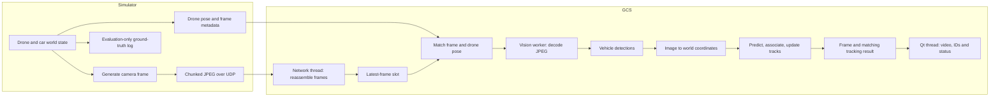

# Moving-Car Detection and Tracking: Architectural Proposal

**Status:** proposed extension, not an implemented feature. The submitted runtime
currently provides drone movement, generated video, UDP transport, and a GCS.
Cars, detection, tracking, overlays, and the performance results discussed below
would be added and evaluated in a subsequent implementation.

## 1. Objective and scope

Introduce cars into the generated world at regular intervals, detect them from
the video received by the GCS, and maintain a unique track ID across observations.
The design must distinguish vehicle motion from apparent motion caused by the
moving drone, tolerate short detection gaps, and preserve responsive controls.

This document addresses the assignment's request for a detailed architectural
proposal and preparation for a technical interview. Its parameter values and
performance thresholds are initial design choices, not measured results.

Assumptions: a top-down camera, translation without camera rotation or zoom, a
flat world, one simulator and one GCS on a trusted LAN, and the current default
stream of 640x480 at 10 FPS. Position and speed remain in simulation units.
Long-term identification after leaving the scene is outside the baseline scope.

## 2. Approach and alternatives

| Approach | Benefit | Trade-off | Decision |
| --- | --- | --- | --- |
| Color/geometry detection + Kalman prediction + global assignment | Fits the generated geometric world; explainable and suitable for CPU evaluation | Depends on the simulator's visual conventions; not a general real-car detector | Recommended baseline |
| Learned vehicle detector + ByteTrack-style association | Appropriate extension for varied real imagery; can use low-confidence detections during association | Requires a suitable dataset/model, runtime dependencies, and deployment-specific latency evaluation | Real-camera extension |
| Motion segmentation after camera stabilization | Can find independently moving regions without defining a car color | Movement alone does not establish vehicle class; stopped cars and imperfect stabilization are difficult | Auxiliary motion evidence |

The baseline is inspired by SORT's combination of Kalman prediction and global
assignment, but uses compensated world positions rather than copying SORT's
image-box state. It should be described as a custom tracker, not a full SORT
implementation. See the original [SORT paper](https://arxiv.org/abs/1602.00763).
For the alternative association strategy, see the original
[ByteTrack paper](https://arxiv.org/abs/2110.06864).

All simulated cars use the same body color. Their persistent IDs must be inferred
from detections and motion, not encoded in colors or drawn into the source image.
Simulator car IDs and exact car positions are available only to an offline
evaluation log. The GCS may use drone pose and camera scale as sensor metadata.

## 3. Architecture and data flow



Tracking belongs on the GCS: it operates on the video actually delivered over
UDP, including compression artifacts and losses, without adding vision work to
the simulator's command loop. Track results are internal GCS data; they do not
require another network channel.

The network thread continues receiving independently of vision. One vision
worker owns the tracker and processes frames serially. It publishes a result
containing the exact decoded image, frame key, tracks, and quality flags. Only the
Qt thread updates widgets. The current JPEG decoding in `gcs.py` would move to
the vision worker so the UI does not decode the same frame again.

Both input and output use a single replaceable slot. New input replaces queued
input, never the frame already being processed. Results are published complete,
and their image buffers are not modified after publication. The UI must not draw
boxes from frame N over a newer, unrelated frame N+1.

`gcs_client.py` would expose an atomic frame snapshot and bounded telemetry lookup
by the full captured frame key. Its current `telemetry_for(frame_id)` only serves
the latest frame, so it cannot safely join an older in-flight image after another
frame arrives. The proposed lookup must return a snapshot for the requested key
without requiring that key to remain the latest, and must reject retired streams.

## 4. Proposed simulated vehicles

Extend the simulator with a separate `CarState` and world update:

- Spawn one car every 3 seconds using elapsed simulation time, with a fixed random
  seed for reproducibility. Bound the population at 20 active cars.
- Start with predefined, intersecting road routes and speeds of 0.5-2.0 world
  units/second. Include stopped cars in validation scenarios.
- Represent each car as a 1.0 x 0.5 world-unit rectangle with a common magenta
  body, a window, and wheels. The source image contains no ID labels.
- Update drone and car positions from the same elapsed-time step, then render
  and timestamp one consistent world snapshot.
- Despawn cars outside a bounded world region, not simply when they leave the
  camera's field of view. The drone can move independently of the cars.
- Add reproducible occlusion scenarios by drawing world-anchored obstacles in
  front of cars. Log visible boxes and occlusion flags for evaluation only.

The internal ground-truth ID is distinct from the tracker ID. A correct tracker
need not guess its numeric value; evaluation checks consistency of their mapping.

## 5. Detection from received pixels

For each complete, decodable JPEG:

1. Convert BGR pixels to HSV and threshold the common car-body color using
   `cv2.inRange`. Initial HSV bounds can be H=140-170, S=100-255, V=80-255 for
   OpenCV's standard 8-bit HSV representation; tune them on decoded JPEGs.
2. Apply small opening/closing operations to remove isolated pixels and repair
   small gaps. Start with a 3x3 kernel and check that nearby cars remain separate.
3. Extract contours and rotated rectangles. Filter by expected area, aspect
   ratio, and filled fraction, with tolerance for compression and partial views.
   Derive size limits from camera scale rather than assuming every resolution
   has the same image-to-world mapping.
4. Return `Detection(bbox_px, center_px, quality_score)`. The score expresses
   geometric/color consistency; it is not a calibrated probability.

The chosen color differs from the current grid, arrow, and landmark colors.
Detection runs before GCS overlays are drawn. Very large merged components and
severely clipped boxes should be flagged as uncertain rather than treated as
reliable single-car measurements. Close or overlapping cars remain a limitation.

These operations are supported by OpenCV's official tutorials on
[HSV thresholding](https://docs.opencv.org/4.x/da/d97/tutorial_threshold_inRange.html),
[morphology](https://docs.opencv.org/4.13.0/d9/d61/tutorial_py_morphological_ops.html),
and [contour bounding boxes](https://docs.opencv.org/4.x/da/d0c/tutorial_bounding_rects_circles.html).
They establish the available operations, not the accuracy of this proposed detector.

## 6. Camera-motion compensation and synchronized metadata

Naive frame differencing would report the scrolling ground and stationary cars
as moving when the drone moves. In the current renderer, the camera transform
is known and can be inverted without estimating background motion.

Let `(xd, yd)` be drone position from the telemetry matching the source frame,
`(u, v)` a detected car center in source-image pixels, and `(cu, cv)` the image
center. With scale `P` pixels/world-unit:

```text
u = cu + P * (yd - ycar)       xcar = xd + (cv - v) / P
v = cv + P * (xd - xcar)       ycar = yd + (cu - u) / P
```

This follows the existing [renderer](../src/drone_gcs/render.py): +X is forward,
+Y is left, and the drone is centered. At 640x480, `(cu,cv)=(320,240)` and the
current `P=35`. For drone `(2,3)` and car `(4,5)`, the image center of the car is
`(250,170)`; applying the inverse recovers `(4,5)`.

The pose must match both `frame_id` and `timestamp_ns`. Never substitute the most
recent pose for a different image. A proposed vision-worker join waits at most
20 ms, measured locally, for matching telemetry. If none arrives, display the
image/detections with a pose-unavailable warning, but do not update world tracks
from those detections. Existing tracks may be predicted briefly and marked
uncertain; their motion classification becomes unknown.

Treat image dimensions and camera scale as versioned configuration shared by
both nodes; include them in metadata if they can change at runtime. Display
resizing happens after detection, so widget dimensions never enter this transform.
For actual image resampling, adjust the pixel scale and detection coordinates.

For real cameras, drone position alone is insufficient. Use camera calibration,
attitude and ground geometry where available; alternatively estimate background
motion from feature correspondences while masking vehicles and using RANSAC.
A planar homography is a possible approximation for a flat scene, not a solution
to arbitrary parallax. OpenCV documents
[homography estimation](https://docs.opencv.org/4.x/d7/dff/tutorial_feature_homography.html).
Unreliable compensation must produce unknown ground motion rather than fabricated
metric speed.

## 7. Tracking, association, and persistent IDs

### Prediction and correction

Each track stores world state `[x, y, vx, vy]`, uncertainty, last measurement time,
box dimensions, hit count, lifecycle state, and a persistent track ID.
Use a constant-velocity Kalman model: predict position as `x += vx*dt` and
`y += vy*dt`, then correct with the compensated center measurement.
`dt` comes from source timestamps of processed frames, not an assumed 0.1 seconds.
Store the filter's current `state_timestamp` separately from its
`last_measurement_timestamp`: predict only from the previous state time to the
new frame time, while expiration uses time since the last actual measurement.
This prevents repeated predictions from integrating the same gap twice.
Measurement noise accounts for pixel localization; process noise allows turns.
OpenCV provides [Kalman prediction/correction](https://docs.opencv.org/4.13.0/dd/d6a/classcv_1_1KalmanFilter.html).

### One-to-one association

Predict all existing tracks to the incoming frame time. Gate impossible matches
before assignment, using displacement, track uncertainty, plausible speed, and
box size. One initial spatial gate is `min(3.0, 0.5 + 4.0*dt)` world units, to be
calibrated for the proposed speeds; it is not an unconditional identity guarantee.

Among permitted pairs, minimize a cost combining normalized world-center
distance with a weaker box-overlap term. Project each prediction into the
current camera view before calculating overlap. An initial weighting is 0.8 for
distance and 0.2 for `1 - IoU`.

Use global linear assignment rather than independently selecting the nearest
car for each track. Include explicit unmatched/dummy choices and exclude gated
pairs so the solver is never forced to match unrelated objects. A proposed
dependency is `scipy.optimize.linear_sum_assignment`, whose official
[documentation](https://docs.scipy.org/doc/scipy/reference/generated/scipy.optimize.linear_sum_assignment.html)
describes minimum-cost assignment. Its implementation is a modified
Jonker-Volgenant solver; it need not be described as a literal Hungarian
implementation. SciPy would be added only if the feature is implemented.

Correct matched tracks, preserve their IDs, and create tentative tracks for
unmatched detections. Prediction is an estimate, not a new detection. If a merged
blob spans multiple predicted cars, avoid forcing it into a confident single-car
update; keep the affected tracks uncertain until separate evidence returns.

### Lifecycle

| State | Transition / display |
| --- | --- |
| Tentative | New detection; require 3 successive matched observations within 0.5 seconds before confirmation. Remove on a miss or failure to confirm within that interval. |
| Confirmed | Matched observation updates the same ID. Show a solid box and a short position trail. |
| Lost / predicted | No reliable match; predict for at most 1.0 second since the last measurement. A gated reappearance can recover the same ID. Show a dashed box only when pose is available. |
| Deleted | Gap exceeds 1.0 second; remove the track. A later detection starts a new ID. |

Use a tracking-session UUID plus a monotonically increasing counter, such as
`session:17`. Never recycle a deleted ID within a session. Restarting the tracker
starts a new namespace; it does not promise continuity with a previous process.

Identity can still be ambiguous when visually identical cars cross or remain
fully occluded. Report uncertainty and measure ID switches; do not promise that
Kalman prediction can recover information that the images do not contain.

## 8. Moving versus stationary

Detect cars whether moving or stopped. Classify motion from compensated, smoothed
world velocity, not raw displacement in image coordinates.

Initial hysteresis: classify moving after speed exceeds 0.2 world units/second
for 3 matched observations; classify stationary below 0.1 for 5 matched
observations. Between thresholds retain an established classification. Before
enough observations, during unreliable compensation, or while only predicting a
lost track, report unknown. Validate thresholds against stationary-car noise and
slow-car scenarios rather than presenting them as universal constants.

Without a calibrated mapping to physical distance, display world units/second
or pixels/second as appropriate, never label either as meters/second.

## 9. Result contract, threading, and latency

A proposed internal result contains:

```text
TrackingResult:
  frame_key: (stream_id, frame_id, timestamp_ns)
  image: decoded source frame
  tracks[]:
    track_id, bbox_px, world_position, world_velocity
    lifecycle, observed_or_predicted, motion_status, quality_flags
  pose_available, local_receive_time, processing_duration
```

The UI adds ID labels, boxes, motion status, and observed/predicted counts to
that same result image. It retains the current video-loss warning and stale-data
behavior. A vision-worker failure should disable overlays with an error status
while preserving video and command handling through a decode-only fallback.

Concretely, catch detection/tracking failures inside the vision worker and
publish the decoded frame with an overlays-unavailable flag. If the worker itself
terminates, the UI can use the existing decode-only display path and report the
worker failure. Do not silently treat old track results as new results.

For clean handling of simulator restarts, the proposed protocol extension adds
a simulator-run `stream_id` to both video headers and telemetry. It is absent
from the current protocol. Admit a new stream only after a complete decodable
frame and matching metadata arrive from the configured simulator. Retire the
previous stream ID for this GCS session, clear its frame/pose slots, and advance
a local generation counter. Tag queued work and results with that generation;
the worker resets its tracker before processing the new generation, and both
publication and presentation reject results from an older generation, including
work that was already in progress at the switch. Late packets from retired IDs
cannot switch the receiver back. Bound retired-ID storage, for example to 256
restarts, and require an explicit receiver-session restart if that budget is
exhausted rather than forgetting IDs and accepting a rollback.

Keep the total datagram size <=1200 bytes after enlarging the versioned header;
old/new protocol versions must fail clearly rather than silently misparse.
Within a stream, discard duplicate/backward frame timestamps. On long gaps,
expire tracks based on elapsed time before association.

Measure performance before optimizing. For 640x480, 10 FPS, and at most 20 cars,
initial CPU targets are p95 vision processing <=50 ms and p95 time from complete
frame receipt to presentation <=100 ms. These targets have not been benchmarked.
On overload, drop queued frames rather than accumulating latency; predict using
the actual timestamp gap and expire tracks if it exceeds the recovery window.

Measure local durations with the GCS monotonic clock. Source timestamps support
frame association and `dt`; subtracting them from a different computer's local
clock does not yield a valid end-to-end latency measurement.

## 10. Failure behavior

| Condition | Intended behavior |
| --- | --- |
| Missing UDP chunk or corrupt JPEG | Ignore incomplete/undecodable frame; do not update tracks from it. Continue with later complete frames. |
| Missing matching drone pose | Warn; skip world-measurement updates; mark motion unknown and avoid displaying old predictions as observations. |
| Brief missed detection / occlusion | Keep a bounded prediction and attempt gated reassociation within 1.0 second. |
| Long occlusion or departure | Delete after the timeout; reacquisition gets a new ID. |
| Duplicate / reordered frame | Process only new source times in the active stream; do not rewind state. |
| Touching cars or ambiguous crossing | Avoid confident merged updates; expose uncertainty and record possible ID switches. |
| Vision slower than input | Replace queued input with the latest frame; maintain bounded memory. |
| Video stops | Keep the current stale-video warning; stop presenting predictions as live evidence. |
| Simulator/tracker restarts | Reset the relevant stream/session namespace explicitly. |

## 11. Validation and acceptance plan

Replay deterministic scenarios through rendering, JPEG compression, UDP reception,
and detection. Tune parameters on one seed set and evaluate on held-out seeds.
Use timestamped ground-truth logs for scoring, never as tracker inputs. Evaluate
only visible ground-truth cars as detections; score occlusion recovery separately.

| Scenario | Check |
| --- | --- |
| One moving car, fixed drone | Confirm the track and preserve its ID; verify speed direction and position error. |
| Stationary car, moving drone | Compensated ground position remains stable; classification becomes stationary. |
| Multiple cars and camera motion | Check one-to-one associations, false detections, and ID switches. |
| Two identical cars crossing | Measure identity errors rather than hiding ambiguous assignments. |
| Occlusion for 0.3 s and 1.5 s | Attempt same-ID recovery for the short gap; expire and allocate a new ID after the long gap. |
| 5% random packet loss plus a 0.3 s burst | Check frame drops, temporal prediction, later recovery, and bounded queues. Packet loss is not the same as frame loss for chunked JPEGs. |
| Missing/reordered pose, duplicate/corrupt frames | No unrelated pose/frame pairing and no backward tracker updates. |
| JPEG quality 45/65 and changed resolution | Quantify detector sensitivity and verify scale handling. |
| Simulator restart and overloaded worker | New session IDs, reject old-stream packets/in-flight results, no stale overlays, responsive controls, bounded memory. |

Record detection precision/recall at a declared IoU threshold (initially 0.5),
ID switches, track fragmentation, position/speed errors, processed FPS, frame-drop
counts, and p50/p95 processing/presentation delays. Target zero ID switches in the
simple isolated-car scenario after confirmation; report actual error rates in
crossing/occlusion scenarios. Broader evaluation could use a standard metric such
as [HOTA](https://arxiv.org/abs/2009.07736), alongside these diagnostic measures.

## 12. Integration sequence and interview discussion

Implementation would proceed through deterministic cars and evaluation logging,
pixel detection, camera compensation and tracking, then worker/UI integration,
restart handling, and fault-injection evaluation. Proposed module boundaries:
`world.py` for car simulation, `vision.py` for detections, `tracking.py` for state
and association, and changes to the existing renderer, simulator, protocol, and
GCS for their integration. These modules and changes have not been created here.

Points to explain in the interview:

- Detection answers "where is a car now?"; tracking links observations over time.
- The simple detector is justified by the controlled simulator. Real imagery
  requires a suitable vehicle detector, representative data, and new evaluation.
- Camera compensation prevents drone movement from being mistaken for car motion.
- Prediction bridges brief missing evidence, but cannot guarantee identity through
  long or ambiguous occlusion. IDs are persistent within a track, not universal
  vehicle identities.
- Video loss, missed detection, and missing pose are separate failure modes.
- Latest-frame scheduling favors fresh results over processing every old frame;
  bounded prediction and explicit stale/unknown states make that trade-off visible.
